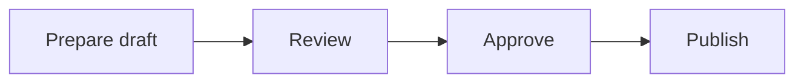

# Inline images, text diagrams and additional publication formats

**Status:** Preliminary options; explicitly deferred. No implementation is
authorised by this document.
**Date:** 3 November 2026.
**Purpose:** Preserve the owner's requirements and the options discussed for
future consideration. This is not an approved implementation design.
**Tracking:** [Git storage TODO](../git/GIT_TODO.md), §4a.

## 1. Why docs-as-code remains the QMS baseline

Our QMS is based on the docs-as-code approach. The owner's working assessment
is that approximately **99% of QMS documentation can be adequately drafted
as text, using inline ASCII art where illustrations are needed**, as already
demonstrated by the 100-plus documents in the existing QMS collection.
Readable headings, lists, tables and fenced, monospaced diagrams are sufficient
for most procedures, responsibilities and process descriptions.

Text-based documentation lets developers, reviewers and readers compare
revisions precisely, merge contributions, search content and use the familiar
suite of coding tools: editors, Git, review tools, scripts and automated
checks. These advantages support traceability and maintenance throughout the
life of the QMS and the organisation's wider corporate information.

Some contributors prefer Microsoft Word, particularly when photographs,
screenshots or elaborate diagrams are involved. There are legitimate cases
where ASCII art is insufficient. Those cases should have practical options,
while text remains the preferred source for the QMS and most corporate
documentation. The lack of a particular image-publication feature does not
prevent the underlying information from being registered and controlled.

The immediate approach is to use the reference and text-based options below.
Larger publication and packaging changes are deferred because their effect
on upload, versioning, approval, storage and rendering may be substantial.

## 2. Doctis's role and existing format support

Doctis is the document control system and index of corporate information.
It was originally intended to register documents whose content lived
elsewhere, and this remains supported. A record can identify an external
document through its Reference, an ISBN/catalogue identifier, and its Link
URL. A primary file is not required for every registered item. See the
[user manual's reference-field explanation](../MANUAL.md#the-reference-field).

Doctis now also offers Git-backed storage for registered primary documents.
Its document-control model is format-agnostic: it can register and store
Word documents, spreadsheets, PDFs, images, CAD files and other formats,
subject to the deployment's permitted file types, size limits and access
rules. Registering, storing, downloading and controlling a document is
separate from rendering its content as a website.

**The current format restriction discussed here belongs to the publication
pipeline.** That pipeline is primarily intended for the Markdown-based QMS;
it currently publishes `.md` / `.markdown` primary documents to HTML and,
where enabled, PDF. It does not currently publish arbitrary stored formats.
See [PUBLISHING.md](PUBLISHING.md).

Doctis is **not a document editor**, and adding one is outside its functional
intent. Authoring remains in external applications. Any proposed contribution
route must respect the existing browser workflow: the user selects **one
file** when uploading a new primary-document version. A proposal involving
several loose files cannot be treated as a drop-in extension to that workflow.

## 3. Short-term options

### A. Refer to an externally hosted, non-classified image

For a suitable non-classified graphic, insert an ordinary URL/link to an
image on an existing approved internet image host or other external medium:

```markdown
See the [example inspection fixture](https://example.org/images/fixture.png).
```

Ordinary Markdown can also express an inline external image:

```markdown

```

**An ordinary link is the immediate reference option.** Inline display depends
on the viewer and its network/content policies. Do not assume the current
PDF pipeline can retrieve and embed an arbitrary internet image. A browser
displaying a remote image does not establish that the PDF or offline copy
contains it.

Use this only for material suitable for external hosting, with the right to
use the image. An external URL can disappear or its content can change
without a Doctis revision; it is therefore a weaker option for an image that
defines a controlled requirement. For such cases, retain a controlled copy
or identify the external source/version sufficiently precisely.

### B. Register the image as a separate Doctis document

Register/store the image using the existing document workflow. Refer to it
from the procedure by its title, document number, Doctis document ID and,
where important, revision. Include a link to the Doctis record, for example:

```markdown
See **Inspection Fixture — IMG-QA-001, revision A**
([Doctis document #123](https://doctis.example/dwg_view.php?id=123)).
```

The identifiers and URL above are examples. This gives the image its own
owner, metadata and controlled history without changing the single-file
upload. It is a **reference to a separately controlled document**, rather
than automatic inline embedding. Readers must have permission to access it;
a link in a published QMS page does not grant that permission.

A document-record link normally leads to the current record, so record the
required image revision explicitly where the procedure depends on it.
Automatically resolving a particular image revision into HTML/PDF would be
new publication work, not an existing capability.

### C. Carry image data inside the single Markdown file

An external authoring tool can encode image bytes in the Markdown file using
a `data:` URI, rather than referring to a separate image file. Conceptually:

```text

```

This preserves a single selected upload containing both text and image.
It is a technical option to evaluate, not a prescribed manual task for
ordinary authors: the external editor or export tool should produce it.

Compatibility must be checked with the chosen editor, reviewers' viewers,
Doctis's Pandoc options/sandbox and both generated HTML and PDF. It has not
been validated end to end in Doctis. Encoding also enlarges the file and
introduces long, opaque blocks into Git diffs; those blocks are not useful
image reviews. Prefer this for occasional small images if the complete
workflow proves suitable. A file containing encoded image bytes is no longer
entirely human-readable documentation, even though its container is text.

### D. Use text-defined diagrams where ASCII art is insufficient

Several diagram languages can live inside fenced Markdown code blocks and
be rendered by compatible viewers or extensions. They retain editable,
searchable text as the source and allow richer illustrations than plain
ASCII art. Strictly, these are diagram languages or renderer extensions,
not universally supported Markdown syntax.

| Language / format | Useful examples | Rendering requirement |
|---|---|---|
| [Mermaid](https://mermaid.js.org/intro/) | Flowcharts, sequence/state diagrams, Gantt charts, entity relationships | A Mermaid-capable viewer or extension |
| [PlantUML](https://plantuml.com/) | UML, activities, sequences and architecture diagrams | PlantUML integration; supporting renderer/tooling |
| [Graphviz DOT](https://graphviz.org/doc/info/lang.html) | Reporting structures, dependency graphs and directed workflows | DOT/Graphviz renderer or Markdown extension |
| [D2](https://d2lang.com/) | Architecture and system/block diagrams | D2 renderer/integration |
| [WaveDrom](https://wavedrom.com/) | Digital timing and waveform diagrams | WaveDrom renderer/integration |
| [Ditaa](https://plantuml.com/ditaa) / [Svgbob](https://github.com/ivanceras/svgbob) | Turn text/ASCII sketches into graphical diagrams | Suitable diagram renderer/integration |

For example, the following remains a single-file text source:

````markdown

````

Many authoring environments offer integrations, but support differs between
viewers. An editor plugin does **not** automatically add support to Doctis
publication. The current publisher has no configured Mermaid/PlantUML/D2
rendering stage; a specialised block may appear as literal code. Validate the
chosen language against actual authoring, review, HTML and PDF tools before
adopting it for a controlled diagram.

This is an immediately available **external-authoring/viewing option**, with
publication integration still to assess. Future support could render text
diagrams locally during publication, retaining the diagram source in the
approved document revision. Private corporate diagrams must not be sent to
a public rendering service merely because a plugin defaults to one. [Kroki's
renderer catalogue](https://docs.kroki.io/kroki/setup/install/) illustrates
the range of available tools; adopting a service is not part of this proposal.

## 4. What non-text content changes, and where LFS fits

Word documents and other binary formats can still be controlled and versioned,
but Git generally cannot provide the same useful line-by-line diffs, merges
and searches as it can for plain text. Format-aware external tools may help;
the generic coding-tool workflow loses much of its direct visibility. Image
changes require visual review even when the surrounding procedure is text.

Repeated versions of large or compressed binary files can substantially grow
ordinary Git history and clone sizes. Small, occasional images need not
justify LFS; this is a question of file sizes, change frequency and retention.
Keeping large binary collections in a dedicated repository/project may help
administration, but it is **not a requirement for LFS**.

### LFS applies to repository content, not only one repository kind

Either a Doctis **document** repository or a **source** repository can carry
LFS-tracked files. The repository's kind/push policy and its `.gitattributes`
tracking rules are separate concerns. A repository can contain ordinary
Markdown alongside selected LFS-tracked binary formats.

However, `.gitattributes` alone does not provide a complete LFS workflow:

1. The Doctis server must have LFS enabled, persistent object storage and
   the required network/deployment configuration.
2. The authoring Git client must have Git LFS configured and commit the
   tracking rules; matching files are then committed as pointers and their
   bytes uploaded to the LFS object store.
3. Existing binary history is not automatically converted by adding tracking
   rules. Any history migration is a separate, coordinated operation.

See [official Git LFS guidance](https://git-lfs.com/),
[Doctis LFS behaviour](../git/GIT_LFS.md) and
[server deployment requirements](../git/LFS_DEPLOYMENT.md).

**The existing browser upload is a separate limitation:** Doctis's server-side
upload path does not currently turn uploaded bytes into LFS pointers and
objects. The web-service identity deliberately has no Git LFS clean/smudge
filters installed. Thus uploading a Word/image file through the browser must
not be assumed to use LFS just because the repository contains tracking rules.
Automatic LFS handling for browser uploads would require its own design and
implementation. Ordinary users should not be expected to configure it.

LFS keeps large bytes out of Git packfiles; it does not eliminate the need
to store and back up each retained version. Current additional limitations
include LFS-aware import not being implemented, source archives carrying
pointer files, and publishing refusing an LFS-backed primary document.
These must be considered before proposing LFS-backed publication.

## 5. Deferred options from the preliminary discussion

### A. Markdown package containing text and images

An external tool could produce one ZIP containing a designated Markdown entry
file and its images. The user uploads one file for the complete revision.

```text
inspection-procedure.zip
  document.md
  images/
    fixture.png
```

Two different storage designs remain open:

- **Archive as the primary file:** retain the ZIP unchanged and extract a
  validated copy only for publication. All components travel together, but
  ordinary Git sees a binary archive rather than readable Markdown changes.
- **ZIP as transport:** unpack and commit the Markdown and assets together,
  identify the complete package as one controlled revision, and reconstruct
  it for download. This preserves individual source files, but needs package
  semantics across upload, versioning, draft/promotion, download and publishing.

The current source-release/tree record is not a ready-made implementation of
a publishable document package: browser replacement uploads and publication
are intentionally unavailable for those records. A package needs its own
deliberate rules rather than reusing a source release incidentally.

### B. Publish a Git-authored Markdown file with companion images

For authors who already contribute through Git, Markdown and images could be
committed together in the repository. The publisher would resolve dependencies
from the document's registered commit and produce HTML/PDF containing the
correct versions. This does not solve multi-file browser uploads by itself.

The current publisher retrieves the primary Markdown file into an isolated
working directory; it does not retrieve arbitrary companion images. Extending
it must preserve the sandbox and define permitted dependencies, path handling,
missing-resource failures and publication cleanup.

An image-only change must be deliberately incorporated into the document's
controlled revision. Referenced assets must not follow the latest repository
branch or silently alter a previously published page. Use revision-specific
published resources or embed image data in the generated HTML as appropriate.

### C. Publish from a native Word source

Keep `.docx` as the primary controlled file, externally authored and uploaded
through the existing single-file dialog. A publication converter could read
the registered version and extract its images, then generate HTML/PDF.
[Pandoc provides Word/media conversion facilities](https://pandoc.org/MANUAL.html#option--extract-media),
but Doctis does not currently expose Word publication.

Test headings, tables, captions, floating objects, drawings/SmartArt, fonts,
page breaks, comments and tracked changes against representative documents.
State which source is authoritative. If a Word import is converted to Markdown
instead, that conversion and its human review are a separate workflow; avoid
two independently edited masters.

### D. Publish a landing page linking the primary document and a generated PDF

The publication pipeline could generate a single HTML **landing page for each
document**, containing its controlled metadata and links to:

- the registered **primary document**, such as the stored Word file; and
- a **PDF generated from that same registered version**.

This would let the QMS website index and navigation include documents whose
body does not render well as an HTML page. Readers could view the PDF or
download the editable source, while Doctis retains the authoritative record.
The landing page would display the title, number, revision, status and link
back to Doctis, consistent with existing published content.

This is a potentially simpler publication target than faithfully converting
the entire Word layout into HTML, but PDF generation remains real work.
Choose and validate an appropriate converter; Word-layout fidelity may require
a different engine from the current Markdown/Pandoc PDF path. Do not assume
that an arbitrary registered format has an automatic PDF converter.

Decide whether the primary-file link is an authenticated Doctis download or
a published copy. A record/download link may require login and may resolve to
the latest version; it must not misrepresent which revision the accompanying
PDF was generated from. Snapshot links/copies need explicit version binding.
Existing classification, access and publication-eligibility rules must apply
to both outputs; publication must not expose a restricted primary file.

Generation failures must be visible, and metadata/source/PDF must identify
the same revision. Define republish, withdrawal/unpublish, retention and
replacement behaviour before making this an operator workflow.

## 6. Decisions for a future review

No development is scheduled by this note. When the work is resumed:

1. Collect representative documents that genuinely exceed text/ASCII needs.
2. Select one or two supported text-diagram formats, if worthwhile, and test
   them in actual review viewers and HTML/PDF publication.
3. Prototype small embedded-image Markdown through the complete pipeline.
4. Compare Markdown packages, Git-authored companion assets, native Word
   conversion and the primary-file/PDF landing-page approach.
5. Decide source authority, asset revision/approval rules, browser-upload
   semantics, LFS needs and publication access before implementation.
6. Define acceptance tests for accurate images/diagrams, stable historical
   versions, missing dependencies, download behaviour, conversion fidelity,
   resource limits and rollback/cleanup.

The preferred starting point remains the existing text-based QMS, supported
by external/image references where appropriate. Future extensions must keep
Doctis a document-control system, preserve the one-file contribution route,
and make the administrative complexity proportionate to the actual need.
